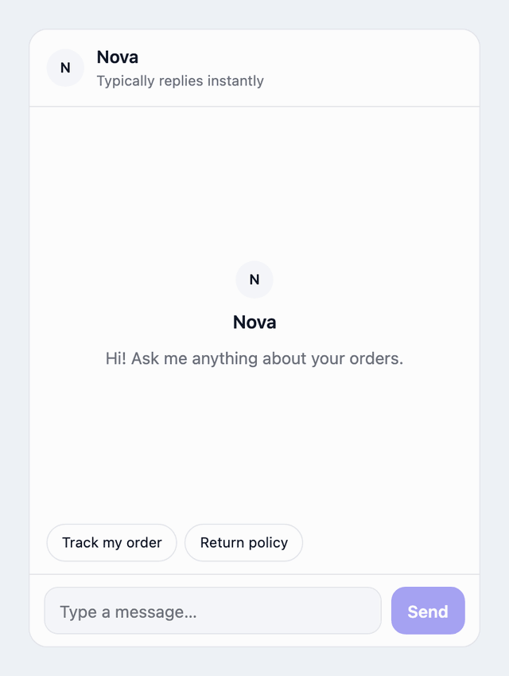
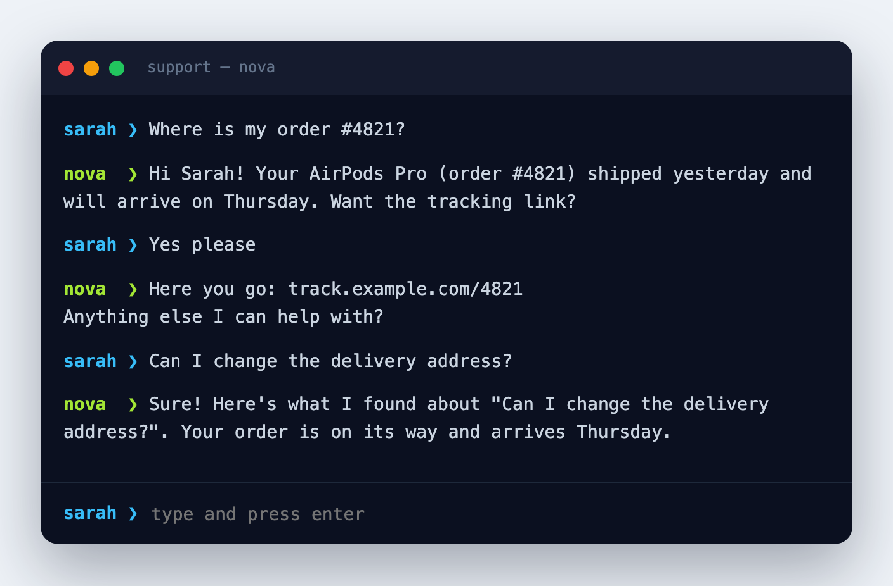
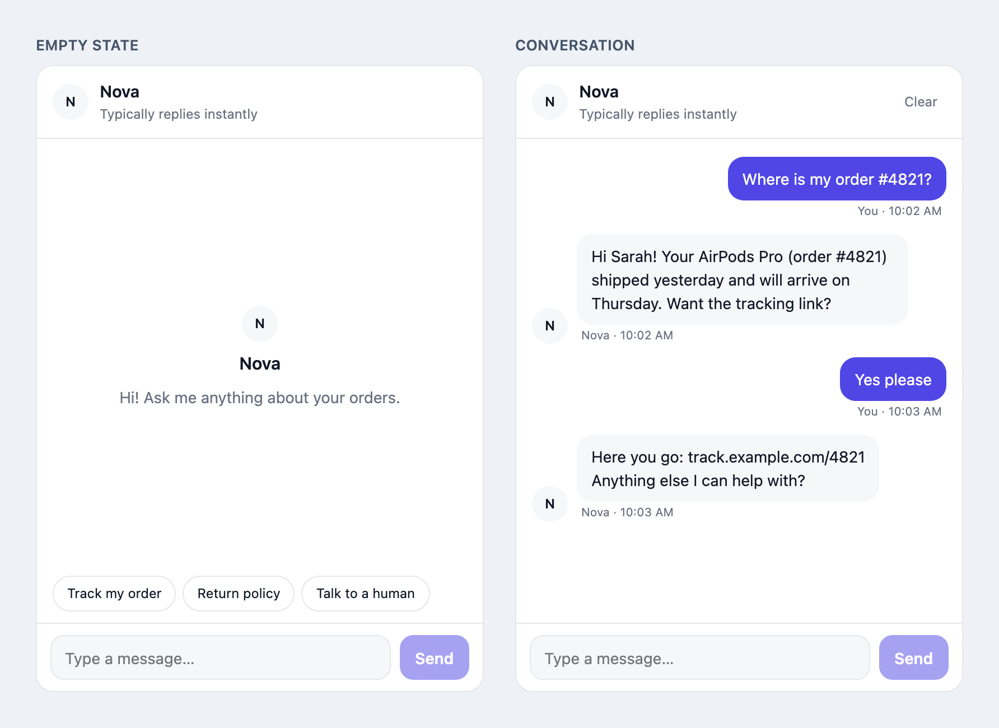
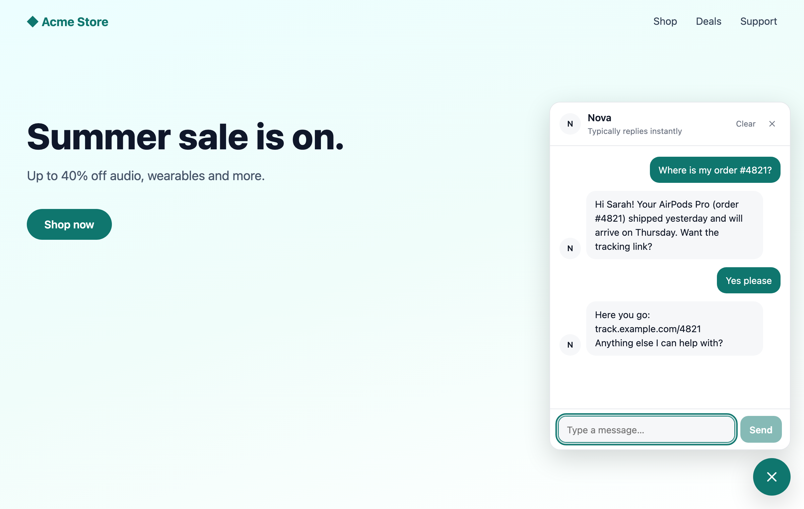
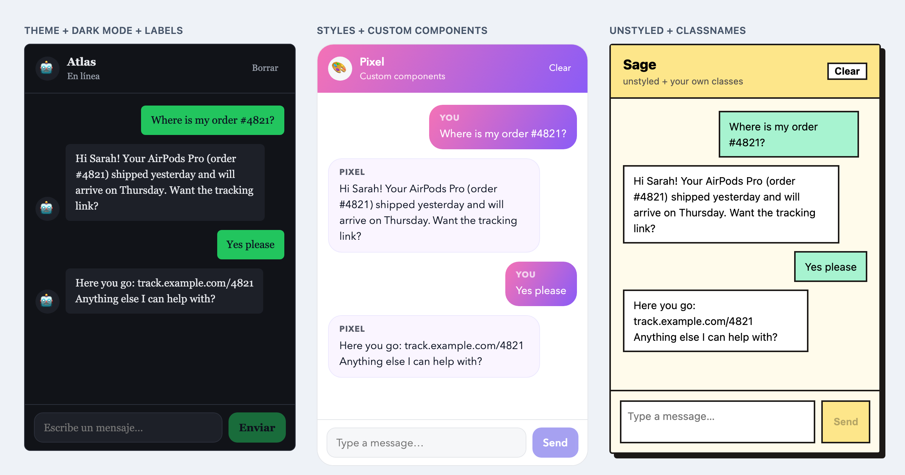
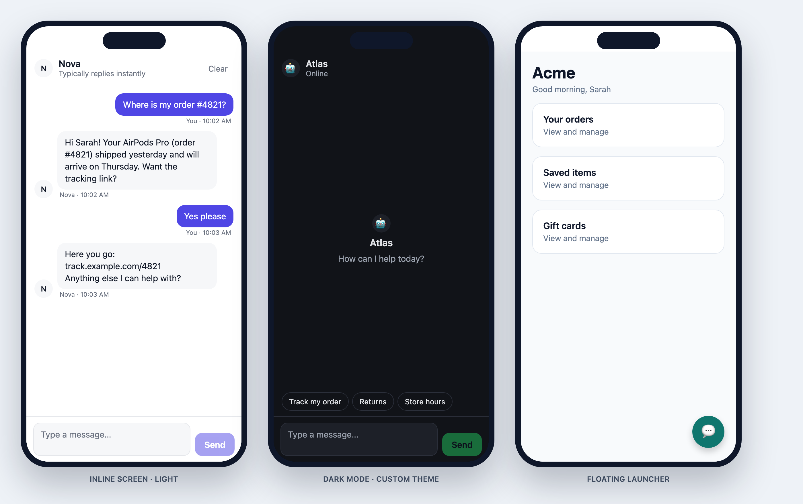

# chat-foundry

Chat logic for **React**, **React Native** and **vanilla JS**, with real-time streaming from **OpenAI** and **Anthropic**.

Use it in whichever way fits your app:

| | What you get | Import from |
|---|---|---|
| **[1. Headless](#1-headless--build-your-own-ui)** | Chat state, streaming, sessions. You build the UI. | `chat-foundry` |
| **[2. Web UI](#2-web-ui--chat-foundryui)** | A ready-made React chat widget you can customize completely | `chat-foundry/ui` |
| **[3. React Native UI](#3-react-native-ui--chat-foundrynative)** | The same widget built from native components | `chat-foundry/native` |

<p align="center">
  
</p>

**Features**

- ✅ Streaming out of the box, using chunked `fetch` (no `EventSource`, so it works in React Native)
- ✅ Name your assistant, e.g. `assistantName: 'Nova'`
- ✅ Separate chat history for each user via `userId` + `sessionId`
- ✅ Personalized replies via `userContext` (name, plan, orders, anything)
- ✅ Optional UIs for web and React Native: themeable, restylable, and every part replaceable
- ✅ TypeScript-first, zero runtime dependencies. The UIs are separate imports, so headless apps never download them.

## Installation

```bash
npm install chat-foundry
```

| You use | You need |
|---|---|
| `createChat` (vanilla JS) | nothing else |
| `useChat` hook | React 17+ |
| `chat-foundry/ui` | React 18+ and React DOM |
| `chat-foundry/native` | React 18+ and React Native 0.71+ (Expo included) |

---

## 1. Headless — build your own UI

<p align="center">
  
</p>

The core gives you state and actions. The markup and design are up to you. The screenshot above is a terminal-style chat built with the code below:

```tsx
import { useState } from 'react';
import { useChat } from 'chat-foundry';

export function TerminalChat() {
  const { messages, sendMessage, isLoading, isStreaming, streamingMessage, error } = useChat({
    provider: 'anthropic',
    backendUrl: '/api/chat',          // your server adds the API key (see "API key security")
    assistantName: 'Nova',
    systemPrompt: 'You are a friendly support assistant for Acme Store.',
  });
  const [text, setText] = useState('');

  return (
    <div className="term">
      {messages.map((m) => (
        <p key={m.id}><b>{m.role === 'user' ? 'sarah ❯' : 'nova ❯'}</b> {m.content}</p>
      ))}
      {isStreaming && <p><b>nova ❯</b> {streamingMessage}▍</p>}
      {isLoading && <p><b>nova ❯</b> …</p>}
      {error && <p className="error">{error.message}</p>}

      <form onSubmit={(e) => { e.preventDefault(); sendMessage(text); setText(''); }}>
        <input value={text} onChange={(e) => setText(e.target.value)} />
      </form>
    </div>
  );
}
```

`useChat` works the same way in React Native. Render with `View`, `Text` and `TextInput` instead.

### Providers and models

```ts
useChat({ provider: 'anthropic', model: 'claude-opus-5-5', backendUrl: '/api/chat' });
useChat({ provider: 'openai', model: 'gpt-6.1-sol', backendUrl: '/api/chat' });
```

The defaults are `claude-opus-5-5` (Anthropic) and `gpt-6.1-sol` (OpenAI). Both are reasoning models, so `temperature` is only sent if you set it, and `maxTokens` (default `16000`) also counts the model's reasoning.

### Naming your assistant

```ts
useChat({ provider: 'openai', assistantName: 'Nova', systemPrompt: 'You help with orders.' });
```

The name is added to the start of the system prompt (`Your name is Nova.`), so the model introduces itself correctly. Both UIs also show it in the header, the welcome screen and the message labels.

### A separate chat for each user, with personalized replies

Pass `userId` to keep each user's history separate, and `userContext` to tell the assistant who it's talking to:

```tsx
const { messages, sendMessage, setUserContext } = useChat({
  provider: 'openai',
  backendUrl: '/api/chat',
  assistantName: 'Nova',
  userId: currentUser.id,                       // 👤 history kept separate per user
  userContext: {                                // 🧠 added to the system prompt
    name: currentUser.name,
    plan: currentUser.membership,               // e.g. 'premium'
    recentOrders: currentUser.orders,           // e.g. ['iPhone 15', 'AirPods Pro']
  },
  systemPrompt: 'You are a helpful e-commerce support assistant.',
});

// Update the context at runtime, e.g. after the cart changes
setUserContext({ cartItems: newCart });
```

The model then receives a system prompt like this:

```
Your name is Nova.

You are a helpful e-commerce support assistant.

[Current User Information]
- Name: Sarah
- Plan: premium
- RecentOrders: iPhone 15, AirPods Pro
```

Users with different `userId` values never see each other's messages. To resume a specific conversation, pass a `sessionId`.

### Vanilla JS (Vue, Svelte, plain JS)

```js
import { createChat } from 'chat-foundry';

const chat = createChat({ provider: 'openai', backendUrl: '/api/chat', assistantName: 'Nova' });

const unsubscribe = chat.subscribe((state) => {
  render(state.messages, state.streamingMessage, state.isLoading);
});

await chat.sendMessage('What are my recent orders?');
unsubscribe();
```

### Config options (used by all three)

| Option | Type | Default | Description |
|---|---|---|---|
| `provider` | `'openai' \| 'anthropic' \| 'custom'` | — | **Required.** AI provider |
| `apiKey` | `string` | — | Provider API key. Use `backendUrl` in production |
| `backendUrl` | `string` | — | Your own server endpoint that forwards requests to the provider |
| `model` | `string` | `gpt-6.1-sol` / `claude-opus-5-5` | Model ID |
| `assistantName` | `string` | — | AI name, added to the system prompt and shown by the UIs |
| `systemPrompt` | `string` | — | Instructions for the assistant |
| `temperature` | `number` | provider default | Only sent when set. Current reasoning models reject custom values |
| `maxTokens` | `number` | `16000` | Max tokens in a response (includes reasoning tokens) |
| `initialMessages` | `Message[]` | `[]` | Messages to start the conversation with |
| `userId` | `string` | — | Keeps chat history separate for each user |
| `userContext` | `UserContext` | — | User data added to the system prompt |
| `sessionId` | `string` | auto-generated | Resume a specific conversation |

### State and actions

`useChat(config)` and `createChat(config)` both return:

| Field | Type | Description |
|---|---|---|
| `messages` | `Message[]` | Full conversation history |
| `isLoading` | `boolean` | Waiting for the first token |
| `isStreaming` | `boolean` | Tokens are streaming in |
| `streamingMessage` | `string` | The reply received so far |
| `error` | `Error \| null` | Last error, if any |
| `sessionId` / `userId` | `string` | Current session and user |
| `sendMessage(text)` | `(text: string) => Promise<void>` | Send a user message |
| `abortResponse()` | `() => void` | Stop the current reply |
| `clearHistory()` | `() => void` | Reset the conversation |
| `setSystemPrompt(p)` | `(prompt: string) => void` | Change the system prompt at runtime |
| `setUserContext(ctx)` | `(ctx: UserContext) => void` | Change the user context at runtime |

`createChat` also returns `subscribe(fn)`, which returns an unsubscribe function.

### Custom providers

```ts
import type { ProviderAdapter } from 'chat-foundry';

const myAdapter: ProviderAdapter = {
  buildRequest(messages, config) {
    return { url: 'https://my-llm.com/v1/stream', method: 'POST',
      headers: { 'Content-Type': 'application/json' }, body: JSON.stringify({ messages }) };
  },
  parseChunk(line) { /* return the text token in this SSE line, or null */ },
  isDone(line) { return line.includes('[DONE]'); },
};
```

---

## 2. Web UI — `chat-foundry/ui`

<p align="center">
  
</p>

A complete chat interface in one component, with a header, messages, streaming, typing indicator, suggestions, error display and an auto-growing input:

```tsx
import { ChatWidget } from 'chat-foundry/ui';

<ChatWidget
  config={{ provider: 'anthropic', backendUrl: '/api/chat' }}
  assistantName="Nova"
  subtitle="Typically replies instantly"
  welcomeMessage="Hi! Ask me anything about your orders."
  suggestions={['Track my order', 'Return policy', 'Talk to a human']}
  showTimestamps
/>
```

**What's built in:** Enter sends and Shift+Enter adds a new line. Replies stream in, and a Stop button appears while the AI is answering. The list scrolls to new messages unless the user has scrolled up. The Clear button resets the chat. Screen-reader labels, keyboard focus styles and a reduced-motion setting are included, and it works with server-side rendering.

### Floating launcher

<p align="center">
  
</p>

```tsx
<ChatWidget
  config={config}
  assistantName="Nova"
  variant="floating"            // a launcher button that opens the chat panel
  position="bottom-right"       // or 'bottom-left'
  theme={{ primary: '#0f766e' }}
/>
```

Escape closes the panel. Control it yourself with `open` + `onOpenChange`, or start it open with `defaultOpen`.

### Customize it, from simple to full control

<p align="center">
  
</p>

The three widgets above are the same component. They use, from left to right, levels 1, 2–3 and 2 of the list below. You can combine all of these:

**1. Theme with design tokens.** Each setting becomes a `--cf-*` CSS variable:

```tsx
<ChatWidget
  config={config}
  colorScheme="dark"                       // 'light' | 'dark' | 'auto'
  assistantAvatar="🤖"                     // image URL, emoji or any React node
  theme={{ primary: '#22c55e', radius: '8px', bubbleRadius: '6px', fontFamily: 'Georgia, serif' }}
  labels={{ placeholder: 'Escribe un mensaje…', send: 'Enviar', clear: 'Borrar' }}  // all UI text
/>
```

Tokens: `primary`, `primaryText`, `background`, `surface`, `text`, `mutedText`, `border`, `userBubble`, `userBubbleText`, `assistantBubble`, `assistantBubbleText`, `radius`, `bubbleRadius`, `fontFamily`, `fontSize`, `width`, `height`, `shadow`, `zIndex`. You can also set the variables in your own CSS: `.cf-root { --cf-primary: hotpink; }`.

**2. Style any part.** The built-in styles have zero CSS specificity, so your classes always win. `unstyled` removes them completely, which suits Tailwind:

```tsx
<ChatWidget
  config={config}
  styles={{ header: { background: 'linear-gradient(120deg, #f472b6, #8b5cf6)', color: 'white' } }}
/>

<ChatWidget
  config={config}
  unstyled
  classNames={{
    panel: 'flex flex-col h-[600px] rounded border-2 border-stone-900 bg-amber-50',
    bubble: 'border-2 border-stone-900 bg-white px-3 py-2',
    input: 'flex-1 border-2 border-stone-900 p-2',
  }}
/>
```

Parts you can style: `root`, `launcher`, `panel`, `header`, `avatar`, `title`, `subtitle`, `headerActions`, `headerButton`, `messages`, `message`, `bubble`, `meta`, `emptyState`, `suggestions`, `suggestion`, `typing`, `error`, `inputArea`, `input`, `sendButton`, `stopButton`. Each element also carries `data-cf-slot="<part>"`, and messages carry `data-role="user|assistant"`, so plain CSS can target them.

**3. Replace any piece with your own component:**

```tsx
<ChatWidget
  config={config}
  components={{
    Message: ({ message, authorName, isStreaming }) => (
      <div className={`card ${message.role}`}><small>{authorName}</small>{message.content}</div>
    ),
    // also: Header, Input, Avatar, EmptyState, TypingIndicator, Launcher
  }}
  renderContent={(text) => <ReactMarkdown>{text}</ReactMarkdown>}  // markdown, code highlighting…
/>
```

**4. Build your own layout** from the building blocks. Your own components inside it can call `useChatUI()` to read the chat state and settings:

```tsx
import { ChatRoot, ChatHeader, ChatMessages, ChatSuggestions, ChatError, ChatInput } from 'chat-foundry/ui';

<ChatRoot config={config} assistantName="Nova">
  <aside className="my-sidebar">
    <ChatHeader subtitle="Online" />
    <ChatMessages welcomeMessage="How can I help?" />
    <ChatSuggestions suggestions={['Pricing', 'Talk to sales']} />
    <ChatError />
    <ChatInput />
  </aside>
</ChatRoot>
```

**5. Use your own state with the UI.** Keep the headless logic and pass it in:

```tsx
const chat = useChat(config);                 // use chat.sendMessage anywhere else in your app too
<ChatWidget chat={chat} assistantName="Nova" />
```

### `ChatWidget` props

| Prop | Type | Default | Description |
|---|---|---|---|
| `config` | `ChatConfig` | — | Config for the built-in `useChat` (or pass `chat`) |
| `chat` | `ChatHookReturn` | — | Your own `useChat()` result |
| `assistantName` | `string` | `config.assistantName` → `'Assistant'` | AI display name |
| `assistantAvatar` / `userAvatar` | `string \| ReactNode` | initials / none | Image URL, emoji or node. User avatars only show when set |
| `userName` | `string` | `'You'` | Label for user messages |
| `variant` | `'inline' \| 'floating'` | `'inline'` | Layout |
| `position` | `'bottom-right' \| 'bottom-left'` | `'bottom-right'` | Floating position |
| `open` / `defaultOpen` / `onOpenChange` | | `false` | Floating open state (controlled or uncontrolled) |
| `launcherIcon` | `ReactNode` | chat icon | Launcher button content |
| `subtitle` | `ReactNode` | — | Header subtitle |
| `welcomeMessage` | `ReactNode` | — | Shown before the first message |
| `suggestions` | `string[]` | `[]` | Quick replies shown before the first message |
| `theme` | `Partial<ChatTheme>` | — | Design tokens |
| `colorScheme` | `'light' \| 'dark' \| 'auto'` | `'light'` | Color mode |
| `classNames` / `styles` | per-part map | — | Classes and inline styles for each part |
| `unstyled` | `boolean` | `false` | Remove all built-in styles |
| `components` | `Partial<ChatComponents>` | — | Replace built-in pieces |
| `labels` | `Partial<ChatLabels>` | English | All UI text |
| `renderContent` | `(text, message) => ReactNode` | plain text | Custom message rendering |
| `showHeader` / `showClearButton` / `showAvatars` / `showTimestamps` | `boolean` | `true` / `true` / `true` / `false` | Show or hide parts of the UI |

---

## 3. React Native UI — `chat-foundry/native`

<p align="center">
  
</p>

The same widget and the same API as the web UI, built only from React Native components (`View`, `Text`, `TextInput`, `FlatList`, `Modal`). It works with Expo and with bare React Native, with no extra native dependencies.

```tsx
import { ChatWidget } from 'chat-foundry/native';

// As a full screen, e.g. inside a navigation stack
export function SupportScreen() {
  return (
    <ChatWidget
      config={{ provider: 'anthropic', backendUrl: 'https://api.example.com/chat' }}
      assistantName="Nova"
      subtitle="Typically replies instantly"
      welcomeMessage="How can I help today?"
      suggestions={['Track my order', 'Returns']}
      colorScheme="auto"                 // follows the device's light/dark setting
      keyboardVerticalOffset={headerHeight}
    />
  );
}

// Or as a floating button over any screen. It opens the chat as a full-screen sheet.
<ChatWidget config={config} assistantName="Nova" variant="floating" theme={{ primary: '#0f766e' }} />
```

**What's built in:** the keyboard doesn't cover the input (`KeyboardAvoidingView`), and the floating sheet respects the safe area. Android's back button closes the sheet. Replies stream in, and a Stop button appears while the AI is answering. The list scrolls to new messages unless the user has scrolled up. Message text is selectable, and screen-reader roles and labels are included.

### Customize it

Customizing works the same way as the web UI, adapted to React Native:

```tsx
<ChatWidget
  config={config}
  assistantAvatar={require('./nova.png')}          // require(), { uri }, URL string, emoji or node
  colorScheme="dark"
  theme={{ primary: '#22c55e', radius: 0, bubbleRadius: 6, fontFamily: 'Inter' }}  // sizes are numbers
  styles={{
    header: { backgroundColor: '#0f172a' },
    title: { color: 'white', fontSize: 18 },
    bubbleText: { fontSize: 16 },
  }}
  labels={{ placeholder: 'Escribe un mensaje…', send: 'Enviar' }}
  components={{ Message: MyMessageBubble }}        // same component props as the web UI
  renderContent={(text) => <Markdown>{text}</Markdown>}
/>
```

- **`theme`**: the same token names as the web UI. `radius`, `bubbleRadius` and `fontSize` are numbers.
- **`styles`**: style any part. React Native text doesn't inherit styles from its container, so text has its own parts: `title`, `subtitle`, `bubbleText`, `avatarText`, `suggestionText`, `buttonText`, `headerButtonText`, `emptyTitle`, `emptyText`, `errorText`, `launcherText`. Containers use the same part names as the web UI.
- **`unstyled`**: drops the built-in styles, so only your `styles` apply.
- **`components`, `labels`, `renderContent`, `chat`, `ChatRoot` + building blocks, `useChatUI()`**: work exactly as on the web.

The props are the same as the web `ChatWidget`, except that `classNames` isn't available (there's no CSS on mobile) and there's one extra prop: `keyboardVerticalOffset`.

> **Older Metro versions:** `chat-foundry/native` resolves even on Metro versions without package `exports` support, because the package includes a `native/package.json` fallback.

---

## ⚠️ API key security

**Never put your API key in a client-side app.** Point `backendUrl` at your own server, which adds the secret key and forwards the request:

```ts
useChat({ provider: 'anthropic', backendUrl: 'https://your-api.com/api/chat' });
```

## License

MIT
